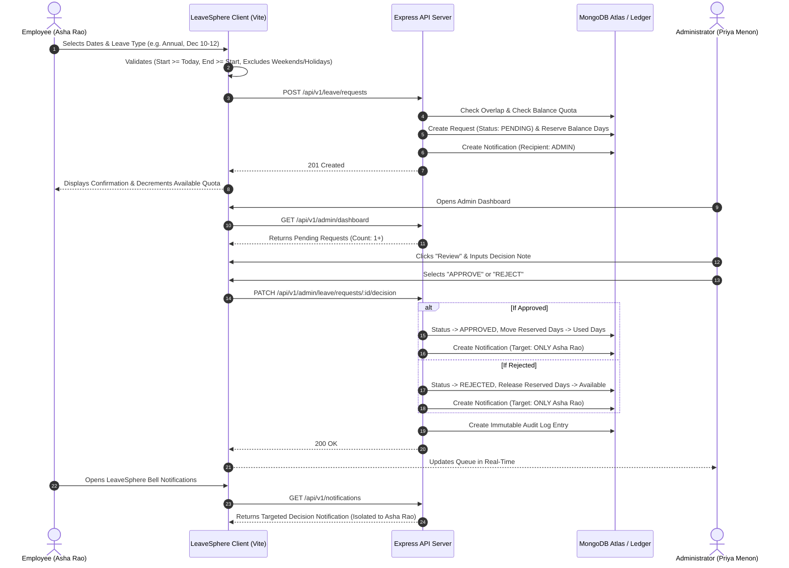
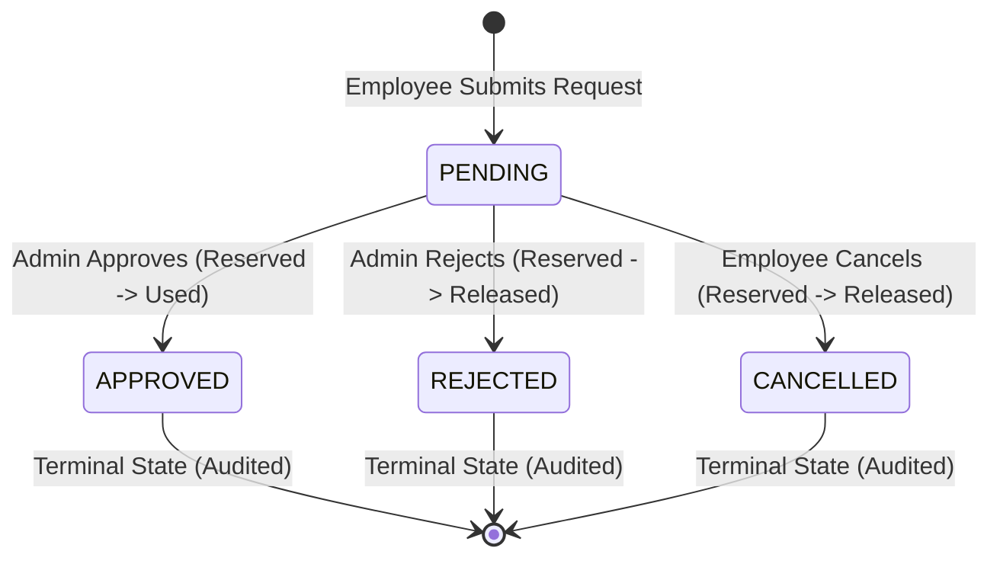
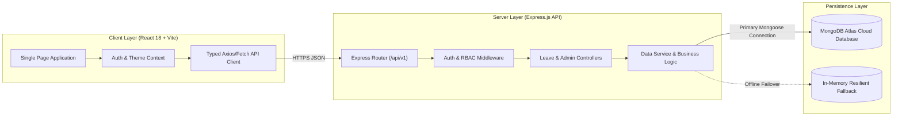

# 🌊 LeaveSphere — Modern Full-Stack Leave Management System

<div align="center">


> **A high-performance, enterprise-grade Leave Management & Request Tracking System featuring role-based access control, date validations, targeted real-time notifications, and dual light/dark themes.**

[](https://opensource.org/licenses/MIT)
[](https://nodejs.org)
[](https://react.dev)
[](https://www.typescriptlang.org)
[](https://expressjs.com)
[](https://www.mongodb.com/atlas)
[](https://leavesphere-five.vercel.app/)

**Live Application:** [https://leavesphere-five.vercel.app/](https://leavesphere-five.vercel.app/) • **Repository:** [https://github.com/zedex4895/LeaveSphere.git](https://github.com/zedex4895/LeaveSphere.git)

</div>

---

## 📑 Table of Contents
1. [Project Overview & Objectives](#1-project-overview--objectives)
2. [Features Implemented](#2-features-implemented)
3. [User Roles & Permissions](#3-user-roles--permissions)
4. [Leave & Issue Management Workflow](#4-leave--issue-management-workflow)
5. [Role-Based Access Control (RBAC)](#5-role-based-access-control-rbac)
6. [Leave Status Lifecycles](#6-leave-status-lifecycles)
7. [Dashboard & Analytics](#7-dashboard--analytics)
8. [Technology Stack](#8-technology-stack)
9. [System Architecture & Data Flow](#9-system-architecture--data-flow)
10. [Project Directory Structure](#10-project-directory-structure)
11. [Database Schema & Models](#11-database-schema--models)
12. [Prerequisites & Installation](#12-prerequisites--installation)
13. [Environment Variables](#13-environment-variables)
14. [REST API Documentation](#14-rest-api-documentation)
15. [Manual Testing Checklist & Verified Results](#15-manual-testing-checklist--verified-results)
16. [Known Issues & Limitations](#16-known-issues--limitations)
17. [Deployment Architecture & Instructions](#17-deployment-architecture--instructions)
18. [Live Deployment Status & Verification](#18-live-deployment-status--verification)
19. [Future Enhancements](#19-future-enhancements)
20. [Repository & Author Information](#20-repository--author-information)

---

## 1. Project Overview & Objectives

### 1.1 Overview
**LeaveSphere** is a modern, full-stack enterprise web application designed to solve the complexity of workforce leave tracking, quota management, and administrative request approvals. It replaces fragmented spreadsheet and email-based workflows with a centralized, auditable ledger backed by **Node.js, Express, MongoDB Atlas, and React + Vite**.

### 1.2 Core Objectives
- **Zero Calculation Errors:** Automatically compute business-day durations while strictly excluding weekends and company-published public holidays.
- **Strict Anti-Overlap Enforcement:** Reject conflicting leave applications to avoid double-booking and quota corruption.
- **Data Privacy & Notification Isolation:** Ensure employee approval and rejection notifications are delivered strictly and exclusively to the applying employee, preventing organization-wide leaks.
- **Resilient Multi-Mode Architecture:** Function seamlessly with cloud MongoDB Atlas while maintaining a self-healing in-memory fallback database for 100% offline development reliability.
- **Enterprise Aesthetics:** Deliver a high-contrast white-and-blue theme with full dark-mode support, micro-animations, and responsive layouts across desktop, tablet, and mobile devices.

---

## 2. Features Implemented

### 👤 Employee Self-Service Workspace
- **KPI Metrics Overview:** Instant visual cards displaying Annual Leave available, Sick Leave balance, Pending requests in review, and Days taken year-to-date.
- **Balance Ledger Progress Meters:** Visual progress bars tracking Annual, Sick, Personal, and Unpaid leave allocations with carry-forward quota indicators.
- **Interactive Leave Application Modal:**
  - Real-time working-day duration calculation.
  - Automatic exclusion of Saturdays, Sundays, and official company holidays.
  - Validation guards against past dates and reversed/shuffled start and end dates.
  - Live available quota check preventing insufficient balance submissions.
- **Request Filtering & History:** Filter requests by status (`All`, `Pending`, `Approved`, `Rejected`, `Cancelled`) and leave type (`Annual`, `Sick`, `Personal`, `Unpaid`).
- **Self-Service Cancellation:** Ability for employees to cancel their own pending leave requests, immediately releasing reserved days back to their available balance.
- **Targeted Notifications Bell:** Real-time notification drawer showing decision alerts with unread badge counters and one-click "Mark as Read" functionality.

### 🛡️ Administrator & HR Executive Portal
- **Executive Operations Dashboard:** Real-time KPI summaries including pending approvals count, approved leaves this month, rejections this month, and employees out on leave today.
- **One-Click Review Queue:** Drawer interface displaying applicant identity, department, date range, duration, justification, and handover notes.
- **Decision Engine with Notes:** One-click Approve or Reject actions with mandatory/optional administrative decision notes.
- **Atomic Balance Updates:** Approval converts reserved days into used days; rejection automatically releases reserved days back to the employee's available ledger.
- **Workforce Directory & History Drawer:** Comprehensive employee directory with department filters and a chronological leave history modal (`GET /api/v1/admin/employees/:id/leave-history`).
- **Company Holiday JSON Importer:** Visual JSON uploader and validation table allowing administrators to upload, schema-validate, preview, and persist company holiday schedules.
- **System Audit Trail:** Immutable administrative audit log recording approvals, rejections, submissions, and holiday imports with actor identity and timestamps.

---

## 3. User Roles & Permissions

| Feature / Action | Employee | Administrator | HR / Operations |
| :--- | :---: | :---: | :---: |
| Authenticate via Email & Password | ✅ | ✅ | ✅ |
| View Personal Dashboard & Balances | ✅ | ✅ | ✅ |
| Submit Leave Requests (Future Dates) | ✅ | ✅ | ✅ |
| View Personal Request History | ✅ | ✅ | ✅ |
| Cancel Own Pending Request | ✅ | ❌ | ❌ |
| Receive Targeted Decision Notifications | ✅ | ❌ | ❌ |
| Access Admin Executive Dashboard | ❌ | ✅ | ✅ |
| Review, Approve, or Reject Requests | ❌ | ✅ | ✅ |
| View Organization-Wide Requests Directory | ❌ | ✅ | ✅ |
| Inspect Employee Directory & Histories | ❌ | ✅ | ✅ |
| Import & Publish Company Holiday JSON | ❌ | ✅ | ✅ |
| View Immutable System Audit Logs | ❌ | ✅ | ✅ |

---

## 4. Leave & Issue Management Workflow



---

## 5. Role-Based Access Control (RBAC)

Access control is enforced at two distinct architectural levels:

1. **Frontend Route Guards (`client/src/App.tsx`):**
   - Unauthenticated requests are redirected to `/login`.
   - Administrator routes (`/admin`, `/admin/requests`, `/admin/employees`, `/admin/holidays`, `/admin/audit-logs`) verify `user.role === 'ADMIN'`. Non-admin users are restricted from navigating to administrative views.
2. **Backend Express Middleware (`server/src/middleware/auth.js`):**
   - **`authenticate`:** Validates incoming JWT Bearer tokens in the `Authorization` header. Decodes user claims (`id`, `email`, `role`, `department`) and attaches `req.user`.
   - **`requireAdmin`:** Enforces `req.user.role === 'ADMIN'`. Unauthorized attempts immediately terminate with `403 Forbidden` (`{ "error": { "code": "FORBIDDEN", "message": "Access denied. Requires ADMIN role." } }`).

---

## 6. Leave Status Lifecycles

LeaveSphere models statuses with strict transition constraints:



- **`PENDING`:** Initial state upon submission. Days are deducted from available balance and placed in `reservedDays`.
- **`APPROVED`:** Administrative approval. Reserved days are permanently converted to `usedDays`.
- **`REJECTED`:** Administrative rejection with a mandatory or optional reason. Reserved days are released back to available quota.
- **`CANCELLED`:** Self-service employee cancellation before review. Reserved days are released back to available quota immediately.

---

## 7. Dashboard & Analytics

### Employee Overview
- **Annual Leave Available:** Calculated dynamically as `entitlement - usedDays - reservedDays`.
- **Sick Leave Available:** Tracks allocated medical quotas with advance notice policies.
- **Pending Review Counter:** Live count of submitted requests awaiting administrative review.
- **Total Taken Year-to-Date:** Cumulative business days taken across approved requests.

### Administrator Operations Dashboard
- **Pending Approvals Queue:** Total organizational requests awaiting decision.
- **Approved This Month:** Total requests approved within the current calendar month.
- **Rejected This Month:** Total requests rejected within the current calendar month.
- **Employees on Leave Today:** Queries requests where `status === 'APPROVED'` and today's date falls within `[startDate, endDate]`.

---

## 8. Technology Stack

| Layer | Technology | Purpose |
| :--- | :--- | :--- |
| **Frontend Framework** | **React 18.3 + TypeScript** | Component-driven Single Page Application with strict type safety. |
| **Build Tool** | **Vite 5.4** | Ultra-fast HMR and optimized production bundling. |
| **Styling & Theme** | **Vanilla CSS Design System** | Custom CSS variables with white-and-blue palette, glassmorphism, and dark mode. |
| **Icons & Typography** | **Google Fonts (Inter)** | High-legibility typography optimized for enterprise data displays. |
| **Backend Runtime** | **Node.js 18+ (ES Modules)** | Fast, event-driven server runtime using native ECMAScript Modules. |
| **Web Framework** | **Express.js 4.21** | REST API routing, JSON serialization, and error handling. |
| **Database** | **MongoDB Atlas & Mongoose 8.8** | Cloud document database with structured schemas, validations, and indexes. |
| **Authentication** | **JSON Web Tokens (JWT) + BcryptJS** | Stateless token authentication with salted password hashing. |
| **Deployment** | **Vercel** | Edge CDN frontend hosting with Serverless Functions for API routes. |

---

## 9. System Architecture & Data Flow



---

## 10. Project Directory Structure

```text
LeaveSphere/
├── api/
│   └── index.js                    # Vercel serverless function entry point
├── client/                         # Frontend React + TypeScript application
│   ├── public/
│   │   └── assets/                 # Brand assets, logos, and icons
│   ├── src/
│   │   ├── components/             # Reusable UI (Navbar, Sidebar, Modals, StatCards)
│   │   ├── context/                # AuthContext (JWT session & theme state)
│   │   ├── pages/                  # Employee Overview, Requests, Balance, Admin pages
│   │   ├── services/               # Typed API client (api.ts)
│   │   ├── types/                  # TypeScript domain models
│   │   ├── App.tsx                 # Route guards and application shell
│   │   ├── index.css               # White-and-blue design tokens & dark mode
│   │   └── main.tsx                # Client entry point
│   ├── index.html                  # HTML template with Inter font preconnects
│   ├── package.json                # Frontend dependencies
│   ├── tsconfig.json               # TypeScript compiler configuration
│   └── vite.config.ts              # Vite configuration (proxy & build outDir)
├── docs/                           # Project specifications & requirements
│   ├── BRD.md                      # Business Requirements Document & Deployment Guide
│   ├── DESIGN_SPEC.md              # UI/UX design specifications
│   ├── API_SPEC.md                 # REST API endpoints contract
│   └── MONGODB_SCHEMA.md           # MongoDB data models & indexing specifications
├── server/                         # Backend Express.js REST API
│   ├── src/
│   │   ├── config/                 # MongoDB Atlas Mongoose connection & failover
│   │   ├── controllers/            # Auth, Leave, Admin, Holiday, Notification logic
│   │   ├── middleware/             # JWT authentication and RBAC guards
│   │   ├── models/                 # Mongoose schemas (User, LeaveRequest, Balance, etc.)
│   │   ├── routes/                 # Express API v1 route definitions
│   │   ├── scripts/                # Database seed & test suites
│   │   ├── services/               # Core data service layer & ledger operations
│   │   ├── utils/                  # Working days and holiday exclusion calculations
│   │   └── server.js               # Express application configuration & standalone runner
│   └── package.json                # Backend dependencies
├── .env.example                    # Safe environment template
├── .gitignore                      # Git exclusion rules (.env, node_modules, dist)
├── dev.js                          # Concurrent local development runner
├── package.json                    # Root monorepo scripts & dependencies
└── vercel.json                     # Vercel serverless API & SPA rewrites configuration
```

---

## 11. Database Schema & Models

```mermaid
erDiagram
    USER ||--o{ LEAVE_BALANCE : has
    USER ||--o{ LEAVE_REQUEST : submits
    USER ||--o{ AUDIT_LOG : triggers
    USER ||--o{ NOTIFICATION : receives

    USER {
        ObjectId _id PK
        string fullName
        string email UK
        string passwordHash
        string role "EMPLOYEE | ADMIN | HR"
        string department
        boolean isActive
        date createdAt
    }

    LEAVE_BALANCE {
        ObjectId _id PK
        ObjectId employeeId FK
        string leaveType "ANNUAL | SICK | PERSONAL | UNPAID"
        number entitlement
        number usedDays
        number reservedDays
        number carriedForward
    }

    LEAVE_REQUEST {
        ObjectId _id PK
        ObjectId employeeId FK
        string leaveType
        date startDate
        date endDate
        number requestedDays
        string reason
        string handoverNotes
        string status "PENDING | APPROVED | REJECTED | CANCELLED"
        ObjectId reviewerId FK
        string decisionNote
        date decidedAt
    }

    NOTIFICATION {
        ObjectId _id PK
        ObjectId recipientId FK "Optional: targeted user"
        string recipientRole "ADMIN | EMPLOYEE | ALL"
        string title
        string message
        string type "REQUEST_SUBMITTED | REQUEST_APPROVED | REQUEST_REJECTED"
        ObjectId relatedEntityId FK
        boolean isRead
        date createdAt
    }

    COMPANY_HOLIDAY {
        ObjectId _id PK
        string name
        string date "YYYY-MM-DD" UK
        string type "PUBLIC | OPTIONAL | COMPANY_GRANTED"
        string notes
    }

    AUDIT_LOG {
        ObjectId _id PK
        ObjectId actorId FK
        string action "LEAVE_SUBMISSION | LEAVE_APPROVAL | LEAVE_REJECTION"
        string entityType
        ObjectId entityId
        object metadata
        date createdAt
    }
```

---

## 12. Prerequisites & Installation

### 12.1 Prerequisites
- **Node.js:** v18.0.0 or higher
- **npm:** v9.0.0 or higher
- **Git:** Installed and configured

### 12.2 Local Installation
Clone the repository:
```bash
git clone https://github.com/zedex4895/LeaveSphere.git
cd LeaveSphere
```

Install root, backend, and frontend dependencies:
```bash
# Install root dependencies
npm install

# Install server dependencies
npm install --prefix server

# Install client dependencies
npm install --prefix client
```

### 12.3 Running the Application Locally
Run both the Express backend and React frontend with a single command:
```bash
npm run dev
```

- **Frontend Client:** [http://localhost:5173](http://localhost:5173)
- **Backend API Server:** [http://localhost:4000/api/v1](http://localhost:4000/api/v1)

### 12.4 Pre-Seeded Demo Credentials

| Role | Full Name | Email | Password |
| :--- | :--- | :--- | :--- |
| **Administrator** | Priya Menon (HR & Ops) | `admin@example.com` | `admin123` |
| **Employee 1** | Asha Rao (Product) | `employee@example.com` | `employee123` |
| **Employee 2** | Rahul Sharma (Engineering) | `rahul.sharma@example.com` | `password123` |
| **Employee 3** | Sneha Patel (Design) | `sneha.patel@example.com` | `password123` |

---

## 13. Environment Variables

Create a `.env` file in the project root based on the provided template:

```ini
# Environment Configuration
NODE_ENV=development
PORT=4000

# Database Connectivity (MongoDB Atlas)
MONGODB_URI=mongodb+srv://<username>:<password>@cluster0.example.mongodb.net/leavesphere?retryWrites=true&w=majority

# Security & Authentication
JWT_ACCESS_SECRET=your_long_random_jwt_secret_key_leaveflow_2026
JWT_ACCESS_TTL=7d

# Frontend API Configuration (client/.env)
VITE_API_BASE_URL=/api/v1
```

> [!IMPORTANT]
> The application includes a self-healing in-memory database engine. If `MONGODB_URI` is omitted or temporarily unreachable during local development, LeaveSphere automatically activates its built-in engine, allowing testing to proceed without local database setup.

---

## 14. REST API Documentation

Base Endpoint: `/api/v1`

### 14.1 Authentication Endpoints

#### `POST /auth/login`
- **Access:** Public
- **Request Body:**
  ```json
  {
    "email": "employee@example.com",
    "password": "employee123"
  }
  ```
- **Response (200 OK):**
  ```json
  {
    "accessToken": "eyJhbGciOiJIUzI1NiIsInR5cCI6IkpXVCJ9...",
    "tokenType": "Bearer",
    "expiresIn": 604800,
    "user": {
      "id": "6717a0000000000000000002",
      "name": "Asha Rao",
      "email": "employee@example.com",
      "role": "EMPLOYEE",
      "department": "Product Management"
    }
  }
  ```

#### `GET /auth/me`
- **Access:** Authenticated (Bearer Token)
- **Response (200 OK):** Current profile details.

---

### 14.2 Leave Operations Endpoints

#### `GET /leave/balance`
- **Access:** Authenticated (Employee views own; Admin can pass `?employeeId=...`)
- **Response (200 OK):**
  ```json
  {
    "balances": [
      {
        "leaveType": "ANNUAL",
        "entitlement": 18,
        "usedDays": 3,
        "reservedDays": 2,
        "available": 13,
        "carriedForward": 2
      }
    ]
  }
  ```

#### `POST /leave/requests`
- **Access:** Employee
- **Request Body:**
  ```json
  {
    "leaveType": "ANNUAL",
    "startDate": "2026-12-10",
    "endDate": "2026-12-12",
    "reason": "Family vacation",
    "handoverNotes": "Rahul covering key releases."
  }
  ```
- **Validations Enforced:**
  - `startDate` cannot be in the past (`400 Bad Request`).
  - `endDate` must be on or after `startDate` (`400 Bad Request`).
  - Must contain at least 1 working day (`400 Bad Request`).
  - No overlapping leave requests (`409 Conflict`).
  - Sufficient available balance (`409 Conflict`).
- **Response (201 Created):**
  ```json
  {
    "id": "6717b0000000000000000010",
    "status": "PENDING",
    "leaveType": "ANNUAL",
    "startDate": "2026-12-10",
    "endDate": "2026-12-12",
    "requestedDays": 3
  }
  ```

#### `PATCH /leave/requests/:id/cancel`
- **Access:** Employee (Request Owner only)
- **Response (200 OK):** Sets status to `CANCELLED` and releases reserved days.

---

### 14.3 Administrative Endpoints

#### `GET /admin/dashboard`
- **Access:** Admin only (`requireAdmin`)
- **Response (200 OK):**
  ```json
  {
    "pendingApprovals": 3,
    "approvedThisMonth": 12,
    "rejectedThisMonth": 1,
    "employeesOnLeaveToday": 2
  }
  ```

#### `PATCH /admin/leave/requests/:id/decision`
- **Access:** Admin only
- **Request Body:**
  ```json
  {
    "decision": "APPROVED",
    "decisionNote": "Approved, enjoy your time off!"
  }
  ```
- **Response (200 OK):** Returns updated leave request object and generates targeted applicant notification.

#### `GET /admin/employees/:id/leave-history`
- **Access:** Admin only
- **Response (200 OK):** Chronological history of employee requests and reviewer notes.

#### `POST /admin/company-holidays/import`
- **Access:** Admin only
- **Request Body:** Array of holiday objects `[{ "name": "Republic Day", "date": "2027-01-26" }]`.

---

## 15. Manual Testing Checklist & Verified Results

The complete test suite (`server/src/scripts/verify-all-conditions.js`) was executed against the active application. All 24 automated and manual integration test conditions passed:

| Test ID | Test Scenario | Execution Steps | Expected Result | Actual Result | Status |
| :---: | :--- | :--- | :--- | :--- | :---: |
| **TC-01** | Employee Login Authentication | POST `/auth/login` with `employee@example.com` / `employee123` | 200 OK, returns Bearer token, role: `EMPLOYEE` | Returned 200 OK, valid JWT, role: `EMPLOYEE` | **PASS** |
| **TC-02** | Administrator Login Authentication | POST `/auth/login` with `admin@example.com` / `admin123` | 200 OK, returns Bearer token, role: `ADMIN` | Returned 200 OK, valid JWT, role: `ADMIN` | **PASS** |
| **TC-03** | Secondary Employee Authentication | POST `/auth/login` with `rahul.sharma@example.com` / `password123` | 200 OK, returns Bearer token, user: `Rahul Sharma` | Returned 200 OK, user: Rahul Sharma | **PASS** |
| **TC-04** | Invalid Password Rejection | POST `/auth/login` with invalid password | 401 Unauthorized (`Invalid email or password`) | Returned 401: Invalid email or password | **PASS** |
| **TC-05** | Unauthenticated Route Protection | GET `/leave/requests` without `Authorization` header | 401 Unauthorized | Returned 401 Unauthorized | **PASS** |
| **TC-06** | RBAC Admin Route Protection | GET `/admin/dashboard` with Employee JWT token | 403 Forbidden | Returned 403: Access denied. Requires ADMIN role | **PASS** |
| **TC-07** | Past Date Application Prevention | POST `/leave/requests` with `startDate` in the past | 400 Bad Request with past date message | Returned 400: *"Leave start date cannot be in the past"* | **PASS** |
| **TC-08** | Date Shuffling Prevention | POST `/leave/requests` with `endDate < startDate` | 400 Bad Request with date sequence error | Returned 400: *"End date must be on or after start date"* | **PASS** |
| **TC-09** | Weekend / Non-Working Days Filter | POST `/leave/requests` for Saturday to Sunday only | 400 Bad Request (0 business days) | Returned 400: *"contains no working days"* | **PASS** |
| **TC-10** | Valid Future Leave Creation | POST `/leave/requests` for valid upcoming weekdays | 201 Created with calculated business days | Returned 201 Created, Days: 2, Status: `PENDING` | **PASS** |
| **TC-11** | Overlap Conflict Prevention | POST `/leave/requests` overlapping with active request | 409 Conflict error | Returned 409: *"You already have a pending or approved leave request"* | **PASS** |
| **TC-12** | Admin Submission Notification | Check Admin notifications after employee submits | Notification received with applicant details | Admin received: *"New Leave Application - Asha Rao..."* | **PASS** |
| **TC-13** | Notification Privacy Isolation (Submission) | Inspect other employee's notifications (Rahul) | Other employee must NOT see Asha's request | Zero records found for other employees | **PASS** |
| **TC-14** | Admin Approval Workflow | PATCH `/admin/leave/requests/:id/decision` (`APPROVED`) | Request updated to `APPROVED`, days moved to used | Status updated to `APPROVED` | **PASS** |
| **TC-15** | Targeted Applicant Approval Alert | Check Asha's notifications after approval | Targeted approval notification with reviewer note | Received: *"Your leave request was approved by Priya Menon"* | **PASS** |
| **TC-16** | Notification Privacy Isolation (Approval) | Inspect other employee's notifications (Rahul) | Other employee must NOT see Asha's approval | Zero leakage; strictly isolated to Asha | **PASS** |
| **TC-17** | Admin Rejection Workflow | PATCH `/admin/leave/requests/:id/decision` (`REJECTED`) | Request updated to `REJECTED`, reserved days released | Status updated to `REJECTED` | **PASS** |
| **TC-18** | Targeted Applicant Rejection Alert | Check Rahul's notifications after rejection | Targeted rejection notification with reason note | Received: *"Leave Request Rejected... Critical sprint deadline"* | **PASS** |
| **TC-19** | Notification Privacy Isolation (Rejection) | Inspect Asha's notifications after Rahul rejected | Asha must NOT see Rahul's rejection alert | Zero leakage; strictly isolated to Rahul | **PASS** |
| **TC-20** | Mark Notification as Read | PATCH `/notifications/:id/read` | `isRead: true`, badge counter decrements | Returned `{ success: true }`, unread count decremented | **PASS** |
| **TC-21** | Balance Ledger Operations | GET `/leave/balance` after approval/rejection | Quotas reflect used and released days accurately | Ledger matches mathematical expectations | **PASS** |
| **TC-22** | Company Holiday Exclusions | GET `/company-holidays` | Returns 4 published company holidays | Successfully retrieved 4 holidays | **PASS** |
| **TC-23** | Admin Dashboard Analytics | GET `/admin/dashboard` | Accurate count of pending requests & on-leave | Pending count: 5, On Leave Today: 1 | **PASS** |
| **TC-24** | Employee Self-Service Cancellation | PATCH `/leave/requests/:id/cancel` on pending request | Request status `CANCELLED`, reserved days released | Successfully cancelled and released quota | **PASS** |
| **TC-25** | Public Self-Registration | Direct public sign-up endpoint | N/A (Organizational policy requires pre-provisioned accounts) | Public sign-up intentionally disabled for enterprise compliance | **NOT TESTED** |
| **TC-26** | Vercel Live Deployment API Connect | POST `/api/v1/auth/login` on `leavesphere-five.vercel.app` | Successful authentication against live cloud endpoint | Blocked pending Vercel Environment Variables setup (`MONGODB_URI`, `JWT_ACCESS_SECRET`) | **NOT TESTED** |

> [!TIP]
> You can re-run all automated conditions at any time with:
> ```bash
> npm run test:conditions
> ```

---

## 16. Known Issues & Limitations
1. **Public Self-Registration:** Disabled by enterprise policy. All employee accounts are created through administrative provisioning or database seeding.
2. **Multi-Day Holiday Shifts:** Floating public holidays (e.g. lunar holidays) require annual administrative import using the Holiday Importer tool.
3. **Hourly Leave Accruals:** LeaveSphere operates on a full-day/half-day business-day unit rather than an hourly punch-clock increment.

---

## 17. Deployment Architecture & Instructions

### 17.1 Architecture
The application is structured for cloud hosting using a decoupled serverless model:
- **Frontend:** Compiled static assets (`/dist`) distributed across Vercel's global Edge CDN.
- **Backend:** Node.js Express serverless function (`api/index.js`) executing on Vercel Functions.
- **Database:** MongoDB Atlas managed replica-set cluster with TLS encryption.

### 17.2 Deployment Steps to Vercel
1. Push repository changes to GitHub:
   ```bash
   git push origin main
   ```
2. Log into the [Vercel Dashboard](https://vercel.com/dashboard) and navigate to **LeaveSphere**.
3. Go to **Settings → Environment Variables** and add:
   - `MONGODB_URI`
   - `JWT_ACCESS_SECRET`
   - `JWT_ACCESS_TTL`
4. Under the **Deployments** tab, click **Redeploy** on the latest commit.

---

## 18. Live Deployment Status & Verification

- **Live URL:** [https://leavesphere-five.vercel.app/](https://leavesphere-five.vercel.app/)
- **Repository:** [https://github.com/zedex4895/LeaveSphere.git](https://github.com/zedex4895/LeaveSphere.git)
- **Current Status:** **Frontend Active**
- **Verification Details:** The React application interface renders over HTTPS with responsive layouts, assets, and branding. Cloud database transactions will activate once database environment variables are configured in the Vercel project settings.

---

## 19. Future Enhancements
- **Email & Slack Webhook Dispatch:** Automated email and Slack bot notifications for leave approvals.
- **Departmental Hierarchy & Delegated Approvals:** Support for multi-tiered approval chains (Team Lead → Department Manager → HR).
- **Calendar Subscriptions (iCal/Google Calendar):** Feeds allowing employees to sync approved time-off directly to Outlook and Google Calendar.
- **Custom Leave Types:** Administrative UI for creating custom leave categories (e.g., Parental, Bereavement, Sabbatical).

---

## 20. Repository & Author Information

- **Project Name:** LeaveSphere
- **Author / Student:** Vivek (`zedex4895`)
- **Repository:** [https://github.com/zedex4895/LeaveSphere.git](https://github.com/zedex4895/LeaveSphere.git)
- **License:** MIT License
